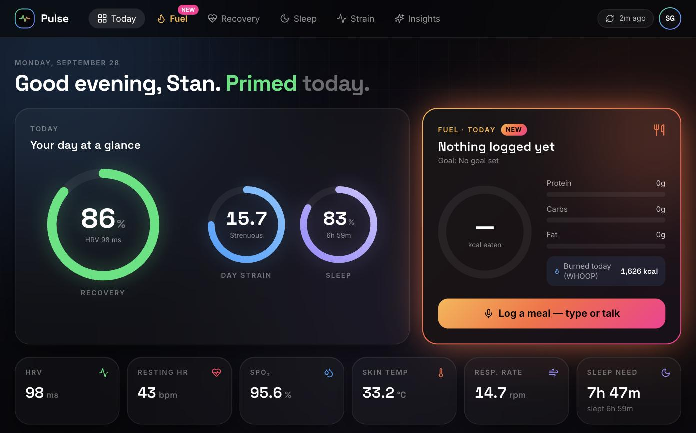
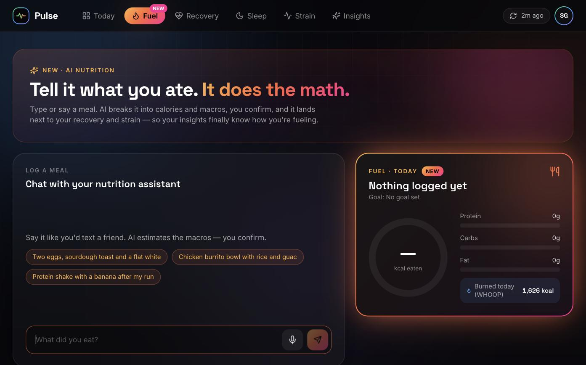
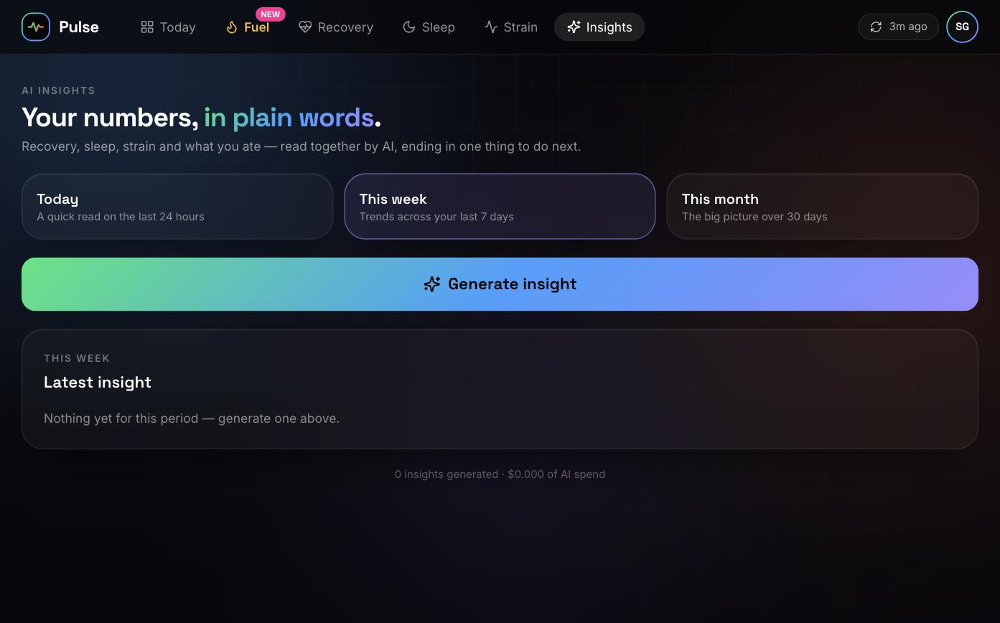
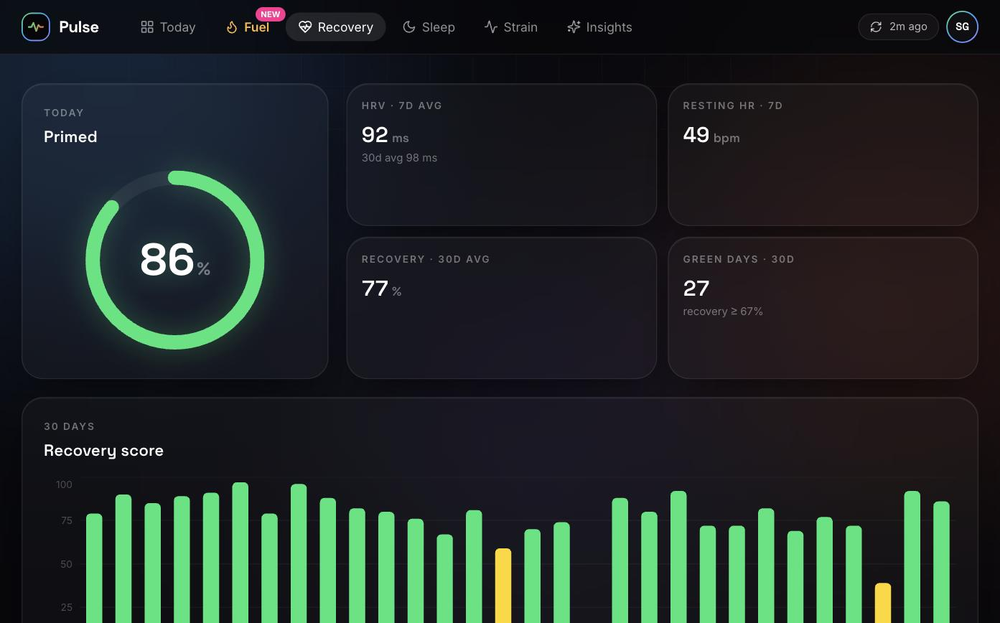
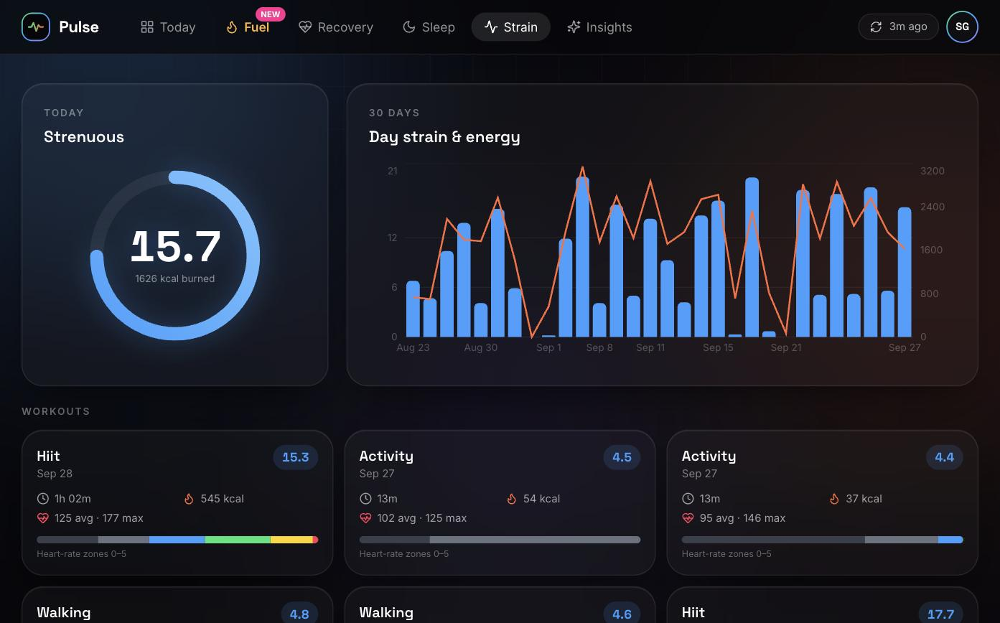
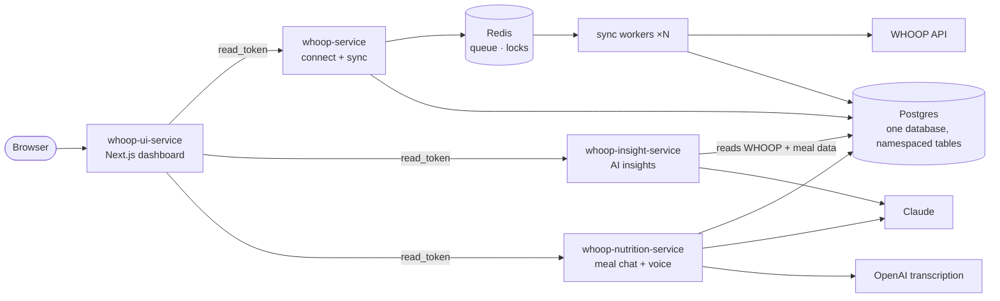

# Pulse

**Your WHOOP data, read together with what you eat.** Connect your WHOOP account to see recovery, sleep and strain. Log meals by just telling it what you ate, typed or spoken. An AI reads it all together and tells you, in plain words, what to do next.

Four small services, built by one person with an AI coding agent ([Claude Code](https://claude.com/claude-code)), **spec first**, in about two weeks of active work.

**No WHOOP band? [Try the demo](https://whoop-ui.onrender.com/login).** One click, no sign-up: you explore the real app as a sample person with a month of data that always ends today, and every AI and WHOOP button plays a pre-written example, so a demo visit costs nothing and never touches real accounts. (Free-plan hosting: the first load after a quiet spell can take 30–60 s.)

> Pulse is an independent side project that uses the WHOOP developer API. It is not affiliated with, endorsed by, or sponsored by WHOOP.



| **Fuel**: say what you ate, confirm the breakdown | **Insights**: everything read together, in plain words |
|---|---|
|  |  |
| **Recovery**: score, HRV and resting HR trends | **Strain**: day strain vs. energy, workouts with HR zones |
|  |  |

## Why

WHOOP tells you *that* your recovery is 41%. It doesn't tell you it's the third low day in a row after two hard workouts and a week of under-eating. Pulse closes that gap:

1. **Morning.** Last night's sleep and this morning's recovery are already on the dashboard; a background worker synced them.
2. **Breakfast.** You tap the mic: *"two eggs, a slice of sourdough with butter, and a flat white."* The assistant proposes ~480 kcal and 24 g protein, and you confirm it. Had you said *"a burrito"*, it would have asked what was in it first.
3. **Evening.** You ask for a weekly insight: *"Recovery has trended down since Tuesday's 16.2-strain session, and you've averaged ~1,650 kcal against a 2,200 target on your two hardest days. Tomorrow, keep strain under 10 and front-load protein at breakfast."*

Everything is per person: many people connect their own WHOOP accounts, and each only ever sees their own data.

## Architecture



Three ideas hold it together:

- **One identity.** Connecting WHOOP is how a person gets a `read_token`. All three backends accept it and check it on every request, so the UI holds no API keys: it acts as the logged-in person, and only that person.
- **One database, clear ownership.** Each service owns its own tables and migration history in a shared Postgres. The insight service *reads* the WHOOP and meal tables, read-only; it never writes or migrates them.
- **Same shape, no shared package.** The three Python services share a layout (`api/`, `core/`, `services/<name>/`) and one set of rules ([the constitution](specs/constitution.md)), but each copies its small `core/` instead of importing it, so each one deploys on its own.

## A walk through the services

### whoop-service: connect and sync

The platform's front door and its data engine. FastAPI API plus RQ workers. [README](whoop-service/README.md) · [spec](specs/whoop-service/)

**Connect.** `GET /auth/login` sends you to WHOOP's own consent page. The callback exchanges the code for WHOOP tokens and encrypts them (Fernet) before they touch the database. It then hands the browser a one-time code that the UI swaps for your `read_token`, so no long-lived secret ever travels in a URL.

**Sync.** Sync is fanned out to workers rather than looped over in one process:
- `POST /sync/batch` (run 3× a day by a GitHub Actions schedule) takes a lock and enqueues one job per connected user in a single pipelined Redis call.
- N worker processes pick the jobs up. Each pages through WHOOP's API with bounded concurrency and retries rate limits and 5xx errors with backoff; an auth error fails fast instead.
- Every row is an **upsert** on `(user_id, whoop_record_id)` with a content hash, so re-syncing changes nothing unless WHOOP's data changed.

**Worth a look:**
- `core/` contains nothing WHOOP-specific, so a second product could reuse it unchanged.
- `user_id` is an explicit parameter everywhere, which is what makes N concurrent workers safe.
- Every log line is structured JSON carrying the user and job IDs.

### whoop-insight-service: what your numbers mean

On demand, for a day, a week or a month. FastAPI plus Claude. [README](whoop-insight-service/README.md) · [LLM learnings](whoop-insight-service/LEARNINGS.md) · [spec](specs/whoop-insight-service/)

It reads your synced recovery, sleep and workouts (and confirmed meals and goals, if you log them) straight from the shared database, builds one prompt, and asks Claude for a 3–5 sentence insight ending in one thing to do next. The period sets the effort: low for a daily check-in, high for a monthly roll-up.

**Worth a look:**
- **Spend is capped before the call, not audited after.** There's a per-user quota and a platform-wide circuit breaker, both checked before every LLM call.
- **No double billing.** A Redis lock stops a double-click from paying for two identical insights.
- **No data, no insight.** If there isn't enough data, it says so instead of calling the model.

### whoop-nutrition-service: log a meal by telling it

Conversational meal logging. FastAPI, Claude tool use, OpenAI Whisper. [README](whoop-nutrition-service/README.md) · [AI learnings](whoop-nutrition-service/LEARNINGS.md) · [spec](specs/whoop-nutrition-service/)

You describe a meal. Claude either asks a clarifying question or calls a strict `propose_meal_breakdown` tool: items, calories, protein, carbs and fat. **Nothing is saved until you confirm it.** Voice goes through a separate transcription seam: the browser records with `MediaRecorder`, the UI server forwards the audio, and Whisper turns it into text before the same chat path runs. The transcript is echoed back so you can see what was heard.

**Worth a look:**
- Goal-aware guidance: weight loss, maintenance, weight gain or muscle gain.
- One spend cap covers both vendors: tokens for Claude, seconds of audio for Whisper.
- A per-conversation lock stops double-submits from interleaving replies.

### whoop-ui-service: the dashboard

Next.js 14 and Tailwind. [spec](specs/whoop-ui-service/)

Today / Fuel / Recovery / Sleep / Strain / Insights tabs, a "refresh from WHOOP" button, the insight generator and the meal chat with a mic button. It's a real client of the backends, with no API keys of its own: every call goes through its server routes, which attach the logged-in person's `read_token` from an `httpOnly` cookie the browser never reads.

**Demo mode** ([spec](specs/001-demo-mode/)). A demo visitor gets a session that holds no credential at all. The dashboard's components ask one hook, `useApiFetch()`, for their fetch function: real users get the browser's own `fetch`, demo visitors get `lib/demo/fakeApi.ts`, an in-browser fake of the app's own `/api` that serves a fixed sample person and scripted AI answers. Nothing reaches a backend, nothing is stored, and tests guard the seams: every real `/api` route must refuse a demo session, every real route must have a demo counterpart, and no component may call `/api` directly.

## How it was built: spec first, with an AI agent

Every service was implemented by Claude Code, and none of it started from a bare prompt:

```
constitution  →  spec (what & why)  →  plan (how)  →  tasks (ordered, each checkable)  →  implement
```

- **[The constitution](specs/constitution.md)** holds 23 rules every service follows: layering, async I/O only, idempotent writes, config and secrets, fail-fast errors. Each rule has an ID that plans and reviews cite.
- **Each service** has a **spec** (user stories, acceptance scenarios, out of scope), a **plan** (structure, key decisions, constitution check) and **tasks** (phased, skeleton first) in [`specs/`](specs/).
- **The agent implemented one task at a time**, and a human reviewed each one against its acceptance check.
- **Features run the same loop.** [Demo mode](specs/001-demo-mode/) went idea → spec → clarifying questions → plan → engineering review of the plan (which changed the design) → test-first tasks → build → code review → browser QA → two releases, each verified in production.
- **Lessons go back into the docs.** When reality disagreed with the plan, the fix went into the code *and* back into the docs. Examples: WHOOP paginates, cross-region latency fails health checks, a free Redis plan counts every command, and an LLM's thinking counts toward its output cap. The two `LEARNINGS.md` files are the most candid part of the repo.

| | |
|---|---|
| Active development | ~15 days, Aug–Oct 2026 |
| Services | 3 Python (FastAPI) + 1 Next.js |
| Source | ~6,000 lines of Python, ~4,200 lines of TypeScript |
| Tests | ~240 pytest cases + 89 Vitest cases, all offline (WHOOP and LLM calls are mocked) |
| CI | lint (ruff), types (mypy), tests, a container CVE scan, and the UI build, on every PR |

## Run it locally

Each Python service has its own `pyproject.toml`, `uv.lock`, and Postgres/Redis containers on their own ports.

```bash
# per backend: whoop-service (8000), whoop-insight-service (8001), whoop-nutrition-service (8002)
cd whoop-service
uv sync
docker compose up -d postgres redis
cp .env.example .env              # fill in values; see the service's README
uv run alembic upgrade head
uv run uvicorn api.main:app --reload
uv run python -m workers.run      # whoop-service only, in a second terminal

# the dashboard
cd whoop-ui-service && cp .env.example .env && npm install && npm run dev   # http://localhost:3000
```

Checks, per Python service: `uv run ruff check . && uv run mypy . && uv run pytest`. For the dashboard: `npm test && npm run typecheck && npm run build`.

The demo needs no backends at all: start only the dashboard and open `/demo/start`.

You'll need a [WHOOP developer app](https://developer.whoop.com/) for the OAuth flow, an Anthropic API key for insights and meal chat, and optionally an OpenAI key for voice.

## Host it yourself

It runs on free or near-free tiers:

| Provider | Role |
|---|---|
| **Render** | the 3 APIs and the UI (free plan), plus the sync worker (small paid instance) |
| **Supabase** | the shared Postgres |
| **Upstash** | Redis for the queue and locks |
| **GitHub Actions** | CI, and the 3×/day batch sync |
| **WHOOP / Anthropic / OpenAI** | OAuth app; insights and meal chat; voice (optional) |

Every service ships a `render.yaml` and a `.env.example`. The full walkthrough covers every env var, where its value comes from, the order to do it in, and a troubleshooting table: **[docs/hosting.md](docs/hosting.md)**.

## Repository map

```
.
├── whoop-service/             WHOOP connect + multi-user sync (API + workers)
├── whoop-insight-service/     AI insights from synced data
├── whoop-nutrition-service/   conversational meal logging, text and voice
├── whoop-ui-service/          the Next.js dashboard
├── specs/                     constitution + spec · plan · tasks per service and per feature
├── docs/hosting.md            host your own copy
├── docs/screenshots/
└── .github/workflows/ci.yml   CI for all four services
```

## License

[MIT](LICENSE)
