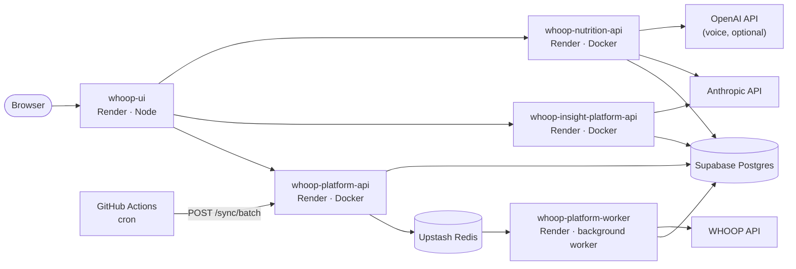

# Hosting quick start

Everything needed to run your own copy of the platform: which providers it uses, what to create on each, which value goes into which environment variable, and the order to do it in. Budget about an hour, most of it waiting for first builds.

## What gets deployed



| Provider | Used for | Plan |
|---|---|---|
| **Render** | 4 web services + 1 background worker, built from this repo's Dockerfiles / Node app | Free for the web services; the worker needs a paid instance type |
| **Supabase** | One Postgres database shared by all three backends (namespaced tables, separate migration histories) | Free |
| **Upstash** | One Redis: the sync queue (RQ), locks, OAuth state, circuit breaker | Free |
| **GitHub Actions** | CI on every push, and the scheduled batch sync (3×/day) | Free |
| **WHOOP developer** | The OAuth app users connect through | Free |
| **Anthropic** | Insights and meal chat | Pay per use, capped in-app at $1/user and $5 total per service |
| **OpenAI** | Voice transcription only — optional | Pay per use |

## 0. Pick one region for everything

Put Render, Supabase and Upstash in the **same region** (this deployment uses Frankfurt / `eu-central-1`). The backends open a fresh database connection per request — Supabase's pooler does the pooling — so every request pays the network round trip. Cross-region, a plain health check took ~2.3s and whoop-service's exceeded Render's 5-second health-check limit, which fails the deploy. Render can't move a service between regions later.

## 1. Put the code on GitHub

Push this repo to your own GitHub account (private is fine) and, in GitHub → Settings → Applications → **Render**, give Render's app access to it. Every push to `main` auto-deploys all services and runs `.github/workflows/ci.yml`.

## 2. Create the accounts' resources

**Supabase** — new project in your region. Under *Connect*, copy two strings:

- **Transaction pooler** (port `6543`) → `DATABASE_URL`
- **Direct connection** (port `5432`) → `DATABASE_URL_DIRECT` (migrations only)

Change each scheme from `postgresql://` to `postgresql+asyncpg://`. URL-encode special characters in the password.

**Upstash** — new Redis database in the same region. Copy the `rediss://default:<password>@<host>:6379` URL → `REDIS_URL`.

**WHOOP** — at developer.whoop.com, create an app with scopes `read:profile`, `read:body_measurement`, `read:cycles`, `read:recovery`, `read:sleep`, `read:workout`, `offline`, and redirect URI `https://<your-api-name>.onrender.com/auth/callback`. Copy the client id and secret.

**Anthropic** — create an API key per service (insight, nutrition), and set a monthly spend limit in the Console. The in-app caps estimate spend from token counts; the Console limit is the one that doesn't depend on this code being right.

**OpenAI** (optional) — an API key for voice input.

## 3. Generate the platform's own secrets

```bash
# TOKEN_ENCRYPTION_KEY — encrypts WHOOP tokens at rest. Never change it later.
python -c "from cryptography.fernet import Fernet; print(Fernet.generate_key().decode())"

# Three operator API_KEYs — one per backend, never shared
openssl rand -hex 32   # whoop-service
openssl rand -hex 32   # whoop-insight-service
openssl rand -hex 32   # whoop-nutrition-service
```

## 4. Fill in the `.env` files

Each service reads its settings from the environment (a local `.env`, or Render's env vars). The same values go in both places; `.env` is git-ignored — only `.env.example` is committed.

**`whoop-service/.env`** — used by the API *and* the worker

```bash
DATABASE_URL=postgresql+asyncpg://postgres.<ref>:<password>@aws-0-<region>.pooler.supabase.com:6543/postgres
DATABASE_URL_DIRECT=postgresql+asyncpg://postgres:<password>@db.<ref>.supabase.co:5432/postgres
REDIS_URL=rediss://default:<password>@<name>.upstash.io:6379
WHOOP_CLIENT_ID=<from WHOOP>
WHOOP_CLIENT_SECRET=<from WHOOP>
WHOOP_REDIRECT_URI=https://<your-api-name>.onrender.com/auth/callback
TOKEN_ENCRYPTION_KEY=<generated>
API_KEY=<generated, whoop-service>
WHOOP_FETCH_CONCURRENCY=3
FRONTEND_URL=https://<your-ui-name>.onrender.com
```

**`whoop-insight-service/.env`**

```bash
DATABASE_URL=<same as whoop-service>
DATABASE_URL_DIRECT=<same as whoop-service>
REDIS_URL=<same as whoop-service>
API_KEY=<generated, insight>
ANTHROPIC_API_KEY=<Anthropic key for insight>
LLM_MODEL=claude-sonnet-5          # optional; must be priced in services/insight/pricing.py
```

**`whoop-nutrition-service/.env`**

```bash
DATABASE_URL=<same as whoop-service>
DATABASE_URL_DIRECT=<same as whoop-service>
REDIS_URL=<same as whoop-service>
API_KEY=<generated, nutrition>
ANTHROPIC_API_KEY=<Anthropic key for nutrition>
OPENAI_API_KEY=<OpenAI key>        # optional — voice input only
LLM_MODEL=claude-sonnet-5          # optional
```

**`whoop-ui-service`** — no secrets, only the backends' URLs

```bash
WHOOP_SERVICE_URL=https://<your-api-name>.onrender.com
INSIGHT_SERVICE_URL=https://<your-insight-name>.onrender.com
NUTRITION_SERVICE_URL=https://<your-nutrition-name>.onrender.com
```

Each service's `.env.example` holds the local-development defaults for the same variables.

## 5. Run the migrations once, from your machine

Render's free instances don't run the `preDeployCommand` in `render.yaml`, so apply migrations by hand — now, and before any later deploy that changes a schema. Order matters: insight and nutrition read whoop-service's tables.

```bash
cd whoop-service           && uv sync && uv run alembic upgrade head
cd ../whoop-insight-service && uv sync && uv run alembic upgrade head
cd ../whoop-nutrition-service && uv sync && uv run alembic upgrade head
```

Each service keeps its own migration history in the shared database (`alembic_version`, `insight_alembic_version`, `nutrition_alembic_version`), and every table has row-level security enabled with no policies, so Supabase's public REST API can't read them.

## 6. Create the Render services

The service names in `render.yaml` become the public URLs (`<name>.onrender.com`). If you rename them, update the hard-coded URLs to match: `WHOOP_REDIRECT_URI` in `whoop-service/render.yaml`, the three URLs in `whoop-ui-service/render.yaml`, and the URL in `.github/workflows/sync.yml`.

In the Render dashboard, create four Blueprints — **New → Blueprint**, pick your repo, and set the Blueprint file path to:

1. `whoop-service/render.yaml` — the API and the worker
2. `whoop-insight-service/render.yaml`
3. `whoop-nutrition-service/render.yaml`
4. `whoop-ui-service/render.yaml`

For each variable marked `sync: false`, Render asks for a value — paste it from step 4. Every Blueprint already pins `region: frankfurt` and `rootDir` to its own directory; change the region if you chose a different one in step 0.

First builds take a few minutes. A free service sleeps after inactivity and takes ~30–60s to wake on the next request — open the health URLs before a demo.

## 7. Turn on the scheduled sync

`.github/workflows/sync.yml` calls `POST /sync/batch` three times a day. Give it whoop-service's operator key:

```bash
gh secret set WHOOP_API_KEY -R <you>/<repo>     # paste whoop-service's API_KEY
```

Trigger it once by hand from the repo's **Actions** tab (*WHOOP batch sync → Run workflow*) to check it.

## 8. Verify

```bash
curl https://<your-api-name>.onrender.com/health          # {"status":"ok"}
curl https://<your-insight-name>.onrender.com/health
curl https://<your-nutrition-name>.onrender.com/health
curl https://<your-ui-name>.onrender.com/api/health       # {"whoop":true,"insight":true,"nutrition":true}
```

Then, in the browser: open the UI → **Connect WHOOP** → log in → the dashboard fills in after the first sync (a few seconds) → **Generate insight** → log a meal in the chat and confirm it.

## When something's off

| Symptom | Likely cause |
|---|---|
| Deploy "Timed Out", instance restarts every few minutes | Health check over 5s — the service isn't in the database's region |
| WHOOP login ends in a WHOOP error page | Redirect URI in the WHOOP app doesn't exactly match `WHOOP_REDIRECT_URI` |
| Login returns to the UI with "exchange failed" | `FRONTEND_URL` doesn't point at the UI, or the one-time code was already used (reload) |
| `relation "..." does not exist` in logs | Step 5 wasn't run against this database |
| Insight/meal chat returns `402` | A spend cap was reached (`GET /insights/spend`, `/nutrition/spend` with the API key) |
| Voice input returns `503` | `OPENAI_API_KEY` isn't set on the nutrition service |
| Dashboard never updates by itself | `WHOOP_API_KEY` secret missing, or the worker service isn't running |
