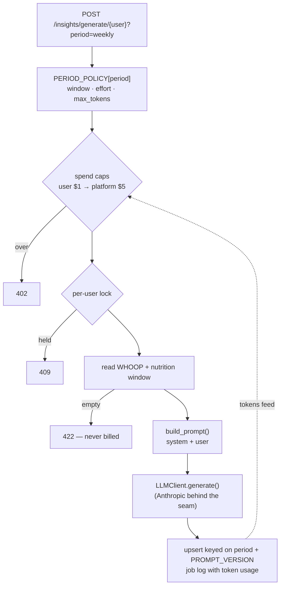

# Learnings — setting up the LLM in whoop-insight-service

## Responsibility

How this service calls Claude, and why each piece is there. The LLM call itself is one line; almost everything around it exists to answer four questions a multi-user product has to answer before that line runs: *which* model and how hard may it think, *how much* may this user and the platform spend, *has this exact request already been paid for*, and *what happens when the provider is slow or down*. Generic API and database setup is left out — see the [README](README.md) for that.

## Design



Every check that can refuse a request runs *before* the paid call, ordered from cheapest to most expensive. The token usage the call returns is the only input to the spend cap, which closes the loop.

## 1. A provider seam, not an SDK dependency

`generate.py` never imports `anthropic`. It depends on a four-line protocol:

```python
# services/insight/llm.py
class LLMClient(Protocol):
    async def generate(
        self, *, system: str, user_prompt: str, max_tokens: int, effort: Effort
    ) -> LLMResult: ...          # LLMResult: text, model, input_tokens, output_tokens
```

`providers/anthropic_client.py` is the only file that knows the SDK. It translates the response into `LLMResult` at the boundary and wraps every `anthropic.APIError` into this service's own `LLMProviderError`, so nothing upstream ever handles a vendor-specific type.

The payoff is less "we might switch vendors" and more testability and containment: every test of the orchestration runs against a fake client injected through FastAPI's `dependency_overrides`, with no network and no spend, and a vendor quirk can only ever leak as far as one file.

**Gotcha — one client per process.** The factory originally built a new `AsyncAnthropic` on every request. Each one owns an HTTP connection pool that was never closed, so every request paid a fresh TLS handshake to the API and leaked a pool. `@functools.cache` on `get_llm_client()` fixes both; tests still override it cleanly.

```python
# services/insight/providers/__init__.py
@cache
def get_llm_client() -> LLMClient:
    return AnthropicLLMClient(api_key=insight_settings.anthropic_api_key,
                              model=insight_settings.llm_model)
```

## 2. The model is restricted to what can be priced

`LLM_MODEL` is configurable, but only to a model listed in `pricing.py`. A pydantic validator rejects anything else at startup:

```python
# services/insight/config.py
@field_validator("llm_model")
@classmethod
def _validate_known_priced_model(cls, value: str) -> str:
    if value not in PRICE_PER_MTOK_USD:
        raise ValueError(f"{value!r} is not in pricing.PRICE_PER_MTOK_USD — add its rate there first")
    return value
```

The reason is the spend cap: it's only as accurate as the price table. A deploy pointed at an unpriced model would silently cost every call at a fallback rate. Failing at boot turns "add a model" into a two-line change that can't be half-done.

## 3. The caller picks a period, never effort or tokens

Nothing in the API lets a caller say "think harder" or "write more". They pick `daily`, `weekly` or `monthly`, and a single table decides the rest:

```python
# services/insight/config.py
PERIOD_POLICY = {
    "daily":   PeriodPolicy(window_days=1,  effort="low",    max_output_tokens=4000),
    "weekly":  PeriodPolicy(window_days=7,  effort="medium", max_output_tokens=8000),
    "monthly": PeriodPolicy(window_days=30, effort="high",   max_output_tokens=16000),
}
```

A daily check-in over one day of data doesn't need deep reasoning; a monthly roll-up over thirty days of three metrics does. `effort` is passed as `output_config={"effort": ...}` and extended thinking is left unset — on this model family effort is the lever for trading thoroughness against cost, and a hand-sized thinking budget isn't. `max_output_tokens` is a ceiling, not a length: the prompt bounds the answer (3-5 sentences), and only generated tokens are billed. It started at 512/768/1024, sized for the answer alone, but thinking counts toward it too (even unshown) and grows with effort, so a monthly insight at `high` effort could be cut off mid-sentence and stored as if complete. The ceilings are now 4000/8000/16000, and the client checks `stop_reason == "max_tokens"` and fails rather than store a cut-off insight (the same lesson as whoop-nutrition-service's meal tool calls).

Adding a period is one row here, not a new parameter threaded through the code.

## 4. Prompt shape: framing in the system prompt, data in the user prompt

```python
# services/insight/prompt.py (condensed)
system = ("You are a sports-science assistant. Given a person's recent WHOOP recovery, sleep, "
          f"and workout-strain scores, write a short, plain-language insight (3-5 sentences) "
          f"framed as {_PERIOD_FRAMING[period]}.{nutrition_clause} End with one concrete, "
          "actionable suggestion. No medical claims. No disclaimers about not being a doctor.")

user = """Recovery scores (0-100, by date):
- 2026-09-21: 64
...
Workout strain scores (0-21, by date):
- 2026-09-22: 11.4"""
```

What held up:

- **Scales stated inline.** "(0-100)" and "(0-21)" next to each heading stop the model from interpreting an 11.4 strain as low.
- **Dated lists, not JSON.** One line per day is compact and reads as a time series without explanation.
- **Optional sections disappear entirely.** With no meals logged, there is no "Meals:" heading and the nutrition clause isn't added to the system prompt. An empty section invites the model to comment on the absence ("you didn't log any meals…"), which is noise for someone who never used the nutrition feature.
- **Explicit guardrails against filler.** "No disclaimers" rules out the boilerplate a health-adjacent prompt tends to attract; "don't force a connection that isn't there" keeps the nutrition correlation honest.

`prompt.py` does no I/O and knows nothing about the provider, so the whole prompt is unit-testable as a string.

## 5. Never pay twice for the same thing

Three independent mechanisms, each catching a different duplicate:

| Duplicate | Mechanism |
|---|---|
| Double-click / client retry while a call is in flight | Redis `SET NX` lock per user, released in `finally` → second request gets `409` |
| Same inputs requested again later | Upsert keyed on `(user, period, start, end, PROMPT_VERSION)`, with a SHA-256 `content_hash` of every input value — an unchanged hash skips the write |
| Nothing to summarize | Empty WHOOP window raises `InsufficientDataError` *before* the call |

`PROMPT_VERSION` is part of the idempotency key on purpose: rewriting the prompt is a new generation, not a silent overwrite of text an older prompt produced.

**Gotcha — the lock must outlive the call.** The lock TTL was 60s, while the SDK's default timeout is minutes and it retries. A slow call would lose its lock mid-flight and let a second, paid request through. Now the relationship is explicit:

```python
# services/insight/config.py
LLM_TIMEOUT_SECONDS = 50.0
LLM_MAX_RETRIES = 1
INSIGHT_LOCK_TTL_SECONDS = 120      # > 50s × (1 + 1 retry) + backoff
```

## 6. Spend caps checked before the call, fed by real usage

```python
# services/insight/generate.py
if await total_spend_usd(db, user_id=user_id) >= INSIGHT_PER_USER_SPEND_LIMIT_USD:  # $1
    raise SpendLimitExceededError(...)
if await total_spend_usd(db) >= INSIGHT_SPEND_LIMIT_USD:                            # $5
    raise SpendLimitExceededError(...)
```

- **Two caps, per-user first.** With only a platform cap, one heavy user exhausts the shared budget and every other user gets a `402` that has nothing to do with them. The per-user cap is the everyday quota; the platform cap is the circuit breaker for "something is badly wrong".
- **Checked before, not audited after.** A crossed cap can be exceeded by at most the one call already in flight.
- **Cost comes from the response, not a guess.** Each successful call's `usage.input_tokens`/`output_tokens` is stored on its job-log row; spend is those counts times `pricing.py`. It's an estimate — the provider's invoice is the truth — so a hard monthly limit in the Anthropic Console sits underneath as defense in depth that doesn't trust this service's bookkeeping.
- **Aggregate in SQL.** The first version loaded every job-log row into Python on every generation. It now sums tokens per model in one grouped query, so the check stays constant-cost as history grows.

## 7. Don't hold a database connection across the LLM call

The generation reads its data, then waits seconds for Claude. Without care, the read transaction stays open for that whole wait, pinning a connection in Supabase's pooler per in-flight generation — with many users generating at once, the pool runs out before the CPU does. One line ends the transaction before the call:

```python
window = await fetch_window(...)
nutrition_window = await fetch_nutrition_window(...)
active_goal = await fetch_active_goal(...)
await db.commit()                     # connection goes back before the slow call
result = await llm_client.generate(...)
```

## 8. Failure is recorded, and stays generic outward

A provider failure becomes `LLMProviderError` → `502 "LLM provider call failed"`. The real reason goes to the structured log and to a `failed` job-log row (with no token counts, so it never counts against spend); it's never returned to the client, where it could leak request details. The lock is always released in `finally`, so a failed call never locks the user out until the TTL.

## 9. Testing without spending

- **Orchestration:** a fake `LLMClient` returning a fixed `LLMResult`, injected with `app.dependency_overrides[get_llm_client]`. Covers caps, lock, empty windows, idempotency and job logs, offline.
- **Provider boundary:** the real `AnthropicLLMClient` with `messages.create` replaced by an `AsyncMock` — proves response parsing and error wrapping without a network call.
- **One real call, on purpose:** `scripts/run_insight_example.py` runs a genuine generation against whatever `.env` points at, for a demo or a prompt change. Small and capped by the same spend caps.

## What would change this design

- **Generations regularly over ~100s** (bigger windows, higher effort): move them onto a queue and worker, like whoop-service's sync, and poll or push the result.
- **Scheduled daily insights for every user:** the provider's batch API is cheaper for non-interactive work than one request per user.
- **A long, stable system prompt** (few-shot examples, a style guide): prompt caching starts paying off. Today the system prompt is a few sentences and the user prompt changes every call, so there's no worthwhile prefix to cache.
