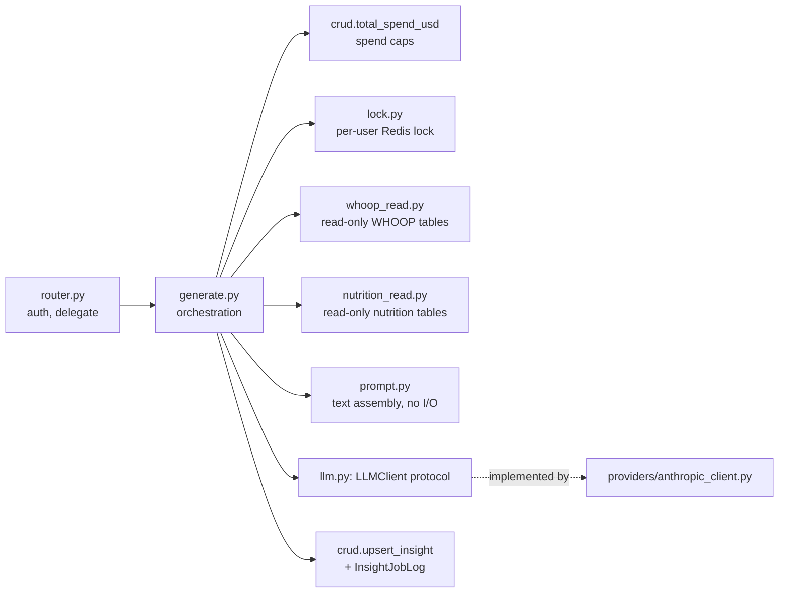
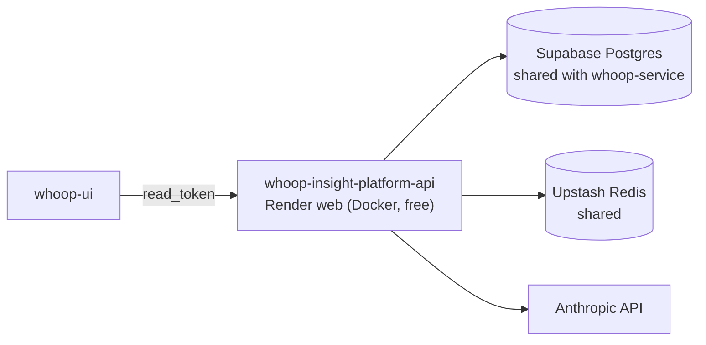

# whoop-insight-service

## Responsibility

Turns a user's already-synced WHOOP data — plus, when they have any, the meals and goal they logged in whoop-nutrition-service — into a short, plain-language insight written by Claude, on demand, for a daily, weekly or monthly window. It never calls WHOOP and never owns WHOOP data; it reads what whoop-service wrote, read-only, from the same database.

What it adds on top of "call an LLM" is control: which model, how much effort and how many output tokens each period may use, a per-user and platform-wide spend cap checked before every call, a per-user lock so a double-click never pays twice, and an idempotency key so unchanged inputs never trigger a second paid generation.

How the LLM side is set up, and why, is written up in [LEARNINGS.md](LEARNINGS.md).

## Design — code structure



```
whoop-insight-service/
├── api/main.py              # router + DomainError -> HTTP mapping
├── core/                    # copied and trimmed from whoop-service: config, db, redis, auth, logging
├── services/insight/
│   ├── router.py            # HTTP routes
│   ├── generate.py          # the one place that wires everything below together
│   ├── config.py            # model, PERIOD_POLICY, spend caps, lock/timeout
│   ├── llm.py               # LLMClient protocol — the provider seam
│   ├── providers/           # concrete clients (Anthropic today) + get_llm_client()
│   ├── prompt.py            # system + user prompt from the data windows
│   ├── pricing.py           # $/token table; also restricts which models may be configured
│   ├── whoop_read.py        # narrow read-only Tables over whoop-service's data
│   ├── nutrition_read.py    # same, over whoop-nutrition-service's meals/goals
│   ├── auth.py              # master key or the user's own read_token
│   ├── lock.py              # SET NX per user
│   └── crud.py, models.py   # insights, insight_job_logs, insight_activity_logs
├── alembic/                 # version table: insight_alembic_version
├── scripts/run_insight_example.py
└── tests/                   # offline: a fake LLMClient, real local Postgres/Redis
```

No queue and no worker: a generation is one bounded request (at most ~100s with timeout and one retry), so it runs inline in the API process. `core/` is copied from whoop-service rather than imported — three small, stable files per service are cheaper to keep in step than a shared package that would couple three independent deploys.

Other services' tables are read through `sqlalchemy.Table` objects on a private `MetaData()`, never on this service's `Base.metadata`. That one choice is what keeps this service's Alembic from ever proposing a migration against a table it doesn't own.

## Design — hosting



One Render web service in Frankfurt. It reuses whoop-service's Supabase database and Upstash Redis rather than provisioning its own; its tables are namespaced (`insights`, `insight_*`) and its migrations use their own version table (`insight_alembic_version`) so the two services' Alembic histories never collide in the shared database. Every table has RLS enabled with no policies, so Supabase's public REST API can't read them.

## Walkthrough

One call: `POST /insights/generate/{user_id}?period=weekly`, authenticated with the user's `read_token`.

```python
# services/insight/generate.py (condensed)
policy = PERIOD_POLICY[period]                       # window_days, effort, max_output_tokens

if await total_spend_usd(db, user_id=user_id) >= INSIGHT_PER_USER_SPEND_LIMIT_USD: raise ...
if await total_spend_usd(db) >= INSIGHT_SPEND_LIMIT_USD: raise ...
if not await acquire_insight_lock(user_id, ttl_seconds=INSIGHT_LOCK_TTL_SECONDS): raise ...

window = await fetch_window(db, user_id, since=since, until=until)       # WHOOP data
if window.is_empty(): raise InsufficientDataError(...)                   # never bill an empty prompt
nutrition_window = await fetch_nutrition_window(db, user_id, since=since, until=until)
active_goal = await fetch_active_goal(db, user_id)
await db.commit()                                    # release the DB connection before the slow call

system, user_prompt = build_prompt(window, period, nutrition_window=..., active_goal=...)
result = await llm_client.generate(system=system, user_prompt=user_prompt,
                                   max_tokens=policy.max_output_tokens, effort=policy.effort)

insight = await upsert_insight(..., content_hash_value=content_hash(window, PROMPT_VERSION, ...))
await write_insight_job_log(..., input_tokens=result.input_tokens, output_tokens=result.output_tokens)
```

1. **Caps first.** The per-user cap ($1) is checked before the platform cap ($5), so one heavy user only ever locks themselves out. Both are checked before the lock and before any paid call.
2. **Lock.** Redis `SET NX` on the user id, released in `finally`. A second request while one is in flight gets `409`, not a second bill.
3. **Read.** The WHOOP window, then the nutrition window and active goal. Nutrition is optional: with none, the prompt is exactly what it was before nutrition existed.
4. **Generate.** `PERIOD_POLICY` decides the effort and output ceiling — `low`/4000 tokens for daily, `high`/16000 for monthly (a ceiling that must also fit the model's thinking; a reply cut off at it fails rather than being stored). The caller only picks the period.
5. **Store.** Upsert keyed on `(user_id, period_type, period_start, period_end, prompt_version)`; the job log records token usage, which is what the spend cap sums.

Failures map to HTTP in one place (`api/main.py`): no data `422`, locked `409`, over budget `402`, provider failure `502`.

## API

| Route | Auth | Purpose |
|---|---|---|
| `POST /insights/generate/{id}?period=` | user | Generate (or return the unchanged) insight |
| `GET /insights/{id}?period=` | user | This user's insights, newest first |
| `GET /insights/{id}/latest?period=` | user | Latest for a period |
| `GET /insights/{id}/usage` · `/activity` | user | Counts, spend, recent activity |
| `GET /insights/spend` | API key | Platform-wide spend vs. cap |
| `GET /health` | — | Postgres + Redis reachable |

## Running locally

```bash
uv sync
docker compose up -d postgres redis          # 5433 / 6380
cp .env.example .env                         # API_KEY, ANTHROPIC_API_KEY
uv run alembic upgrade head
uv run uvicorn api.main:app --reload --port 8001
uv run ruff check . && uv run mypy . && uv run pytest
# one real generation, real (small, capped) spend:
uv run python scripts/run_insight_example.py --user-id <uuid> --period weekly
```
