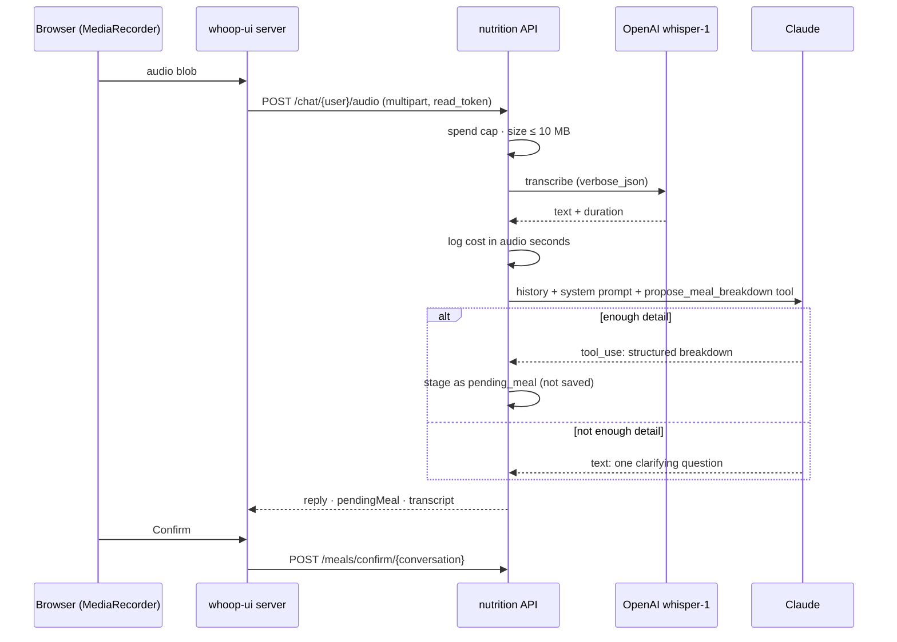

# Learnings — AI and speech-to-text in whoop-nutrition-service

## Responsibility

What this service does differently from whoop-insight-service on the AI side: structured extraction through tool use, a human confirm step, a multi-turn conversation, and a second AI vendor for voice. The foundations — provider seam, cached client, model restricted to what can be priced, spend caps before the call, per-request lock, not holding a DB connection across the call — are the same and are written up once in [whoop-insight-service's LEARNINGS.md](../whoop-insight-service/LEARNINGS.md).

## Design



Voice is a front end to the text path, not a second pipeline: after transcription the transcript goes through exactly the same chat turn a typed message does.

## 1. Tool use as the extraction mechanism

Claude gets one tool, `propose_meal_breakdown`, with a strict JSON schema (`"strict": True`, `additionalProperties: false`, required totals and items). Two settings carry the design:

- **`tool_choice` stays `auto`.** Claude decides whether it has enough to estimate. "I had a burrito" gets a clarifying question in plain text; "a chicken burrito, about the size of my forearm, with rice and beans" gets a proposal. Forcing the tool would make it guess portion sizes it was never told.
- **The prompt says when *not* to call it.** "If you don't have enough detail yet… ask one short clarifying question in plain text instead of guessing — do not call the tool until you have enough to estimate from." The tool description repeats it, so the rule is in front of the model both where it reads instructions and where it decides whether to call the tool.

The provider client turns a `tool_use` block into a typed `MealProposal` at the boundary, so `chat.py` works with dataclasses, never raw tool JSON.

## 2. A strict schema still needs validating

The schema guarantees shape, not meaning. `loggedAt` is typed `string`, and Claude resolves "this morning" into an ISO datetime — sometimes with an offset (`2026-09-27T08:00:00+02:00`), sometimes not, and occasionally not a datetime at all. The first version dropped the offset without converting it, storing that 08:00 meal as 08:00 UTC, two hours off; a non-ISO value crashed only later, at confirm time.

Now the boundary normalizes and rejects:

```python
# services/nutrition/providers/anthropic_client.py
def _naive_utc_iso(value: str) -> str:
    parsed = datetime.fromisoformat(value.replace("Z", "+00:00"))   # ValueError if not ISO
    if parsed.tzinfo is not None:
        parsed = parsed.astimezone(UTC).replace(tzinfo=None)      # convert, don't drop
    return parsed.isoformat()
```

An unparseable value fails the turn as a malformed tool call (`LLMProviderError`), at the point where the bad data entered — not three requests later.

For the model to resolve relative dates at all, the system prompt carries today's date: `Today's date is 2026-09-28.` Without it, "yesterday" has nothing to anchor to.

## 3. Confirm before save

The model's output is never written as data directly. A proposal is staged on the conversation (`pending_meal`, JSONB) and returned; only `POST /meals/confirm/{conversation_id}` writes `nutrition_logs`. Confirming with nothing staged is a `409`, never a silent no-op.

This is what makes LLM-estimated macros acceptable without a nutrition database: every number is seen by a person before it becomes part of their history — and before whoop-insight-service reasons over it.

## 4. A conversation's cost grows with its length

A one-shot insight costs the same every time. A chat turn resends history, so turn 30 costs far more than turn 1. Three bounds keep it flat:

```python
# services/nutrition/config.py
NUTRITION_CONTEXT_MESSAGE_LIMIT = 20      # only the most recent messages are resent
NUTRITION_CHAT_EFFORT = "low"             # a reply doesn't need deep reasoning
NUTRITION_CHAT_MAX_TOKENS = 4000          # a ceiling: must fit thinking + a full breakdown
NUTRITION_MAX_MESSAGE_CHARS = 2000        # caps what one message can add
```

**`max_tokens` is a ceiling for everything the model generates, thinking included.** It started at 400, sized for the visible reply. But Claude Sonnet 5 thinks by default (even at `effort="low"`, and even though the thinking isn't returned), and that counts toward the cap. Long multi-item breakdowns were cut off mid tool call, so the parser saw a `propose_meal_breakdown` input missing its later fields (`malformed tool call: 'totalProteinG'`). `strict: true` doesn't help: it guarantees valid input only for a reply that finishes. The cap is now 4000 (only generated tokens are billed, so a higher ceiling costs nothing extra), and the client checks `stop_reason == "max_tokens"` before parsing any tool call, so a cut-off reply fails with that reason instead of a puzzling missing field.

The lock is per *conversation*, not per user: it stops a double-submit from interleaving two replies into one thread, while still allowing a user to have two separate conversations.

## 5. Speech-to-text as a separate seam

Transcription is a different problem from a different vendor with a different secret and a different billing unit, so it gets its own protocol rather than a branch in the chat client:

```python
# services/nutrition/transcription.py
class TranscriptionClient(Protocol):
    async def transcribe(self, *, audio_bytes: bytes, content_type: str) -> TranscriptionResult: ...
    # TranscriptionResult: text, duration_seconds
```

What the setup needed in practice:

- **Optional key.** `OPENAI_API_KEY` is resolved per request, not at startup. A deployment without it starts normally; only the audio route answers `503 voice input isn't configured`.
- **Duration is the billing unit.** Whisper bills per minute of audio, not tokens. Requesting `response_format="verbose_json"` costs the same and is the only format that returns the real `duration`, which is what gets stored (`audio_seconds`) and priced.
- **One spend cap for both vendors.** Transcriptions and chat turns land in the same job-log table; the cap sums tokens × Claude price and seconds × Whisper price, per model, in one grouped query. The cap is checked *before* transcription, so a request can't cross it with a transcription plus a chat call.
- **The file extension is the format hint.** OpenAI infers the audio format from the uploaded filename, so the content type is mapped to an extension. Browsers send parameters — Safari's `MediaRecorder` reports `audio/mp4;codecs=mp4a.40.2` — which missed the lookup and fell back to `webm`. The lookup now uses the base type.
- **Bound the upload.** The route reads at most 10 MB (`413` beyond it), under the provider's own limit and well above a spoken meal description.
- **Echo the transcript.** The response includes `transcript`, so the user sees what was heard before trusting the breakdown built on it.
- **No key in the browser.** The browser records with `MediaRecorder` and posts the blob to the UI's own server route, which forwards it with the user's `read_token`. Neither vendor key ever leaves the backend.

## 6. Two ways to authorize, because not every route has a user id

Chat routes are keyed by `user_id`; confirm and discard are keyed by `conversation_id`. For the latter, auth resolves *who the caller is* from their token first, then checks they own the conversation. The other order — look up the conversation, then check the token — would let an unrecognized token tell "this id exists" (`404`) from "it doesn't" (`401`).
