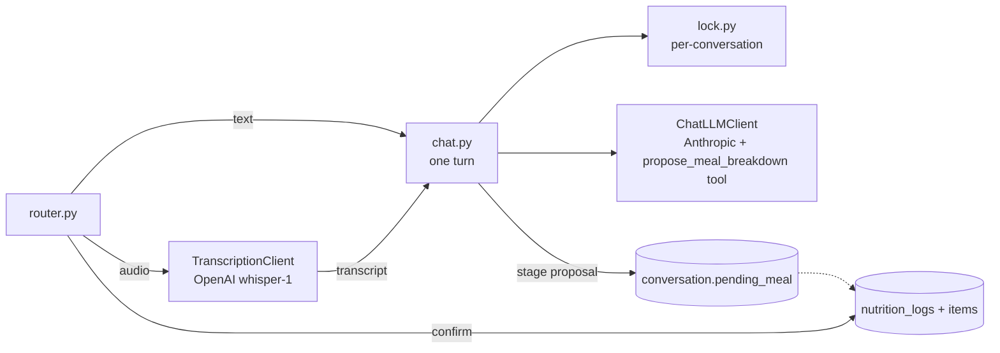
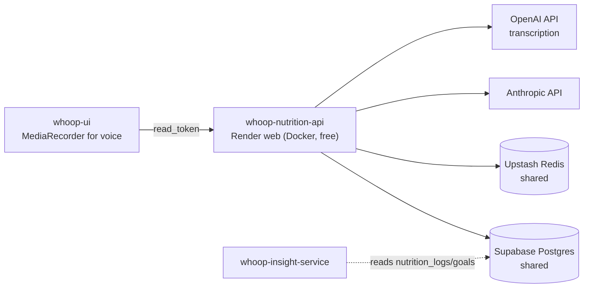

# whoop-nutrition-service

## Responsibility

Conversational meal logging. A user describes a meal — typed, or spoken — and Claude either asks a short clarifying question or proposes a structured nutritional breakdown. Nothing is saved until the user confirms that proposal. Confirmed meals and the user's active goal (weight loss, a calorie target) are what whoop-insight-service folds into its insights.

The nutrition numbers are LLM estimates, not a nutrition-database lookup — good for personal trend tracking, not clinical precision. That's a deliberate scope choice, and the confirm step is what makes it acceptable: a human looks at every number before it becomes data.

How the LLM and speech-to-text sides are set up, and why, is written up in [LEARNINGS.md](LEARNINGS.md).

## Design — code structure



```
whoop-nutrition-service/
├── api/main.py              # router + DomainError -> HTTP mapping
├── core/                    # same trimmed core/ as whoop-insight-service
├── services/nutrition/
│   ├── router.py            # chat, chat/audio, confirm/discard, meals, goals, usage
│   ├── chat.py              # orchestration of one chat turn
│   ├── llm.py               # ChatLLMClient protocol + the propose_meal_breakdown tool schema
│   ├── transcription.py     # TranscriptionClient protocol — a separate seam, separate vendor
│   ├── providers/           # anthropic_client.py, openai_whisper_client.py, factories
│   ├── prompt.py            # system prompt: today's date + active goal
│   ├── pricing.py           # $/token (Claude) and $/minute (Whisper); restricts configurable models
│   ├── config.py            # models, caps, context limit, request bounds, lock/timeout
│   ├── auth.py              # read_token by user_id, or by conversation ownership
│   ├── lock.py              # SET NX per conversation
│   └── crud.py, models.py   # conversations, messages, logs, items, goals, job/activity logs
├── alembic/                 # version table: nutrition_alembic_version
├── scripts/run_chat_example.py
└── tests/                   # offline: fake chat + transcription clients
```

Two provider seams, not one. Chat (Anthropic) and transcription (OpenAI) solve different problems, bill in different units (tokens vs. audio minutes) and hold different secrets, so each has its own protocol and factory. `OPENAI_API_KEY` is optional: without it the service starts and only the audio route returns `503`.

A confirmed meal is a plain insert, never an upsert — eating the same breakfast twice is two events. That's the opposite of whoop-service's records and whoop-insight-service's insights, both of which are re-derivable and therefore keyed for idempotency.

## Design — hosting



One Render web service in Frankfurt, on the same shared Supabase database and Upstash Redis as the other two services. Tables are namespaced `nutrition_*`, migrations use `nutrition_alembic_version`, and every table has RLS enabled with no policies. whoop-insight-service reads `nutrition_logs` and `nutrition_goals` directly (read-only); if you change those columns here, check `whoop-insight-service/services/insight/nutrition_read.py`.

## Walkthrough

**1. A turn.** `POST /nutrition/chat/{user_id}` with `{"message": "two eggs and toast this morning"}`:

```python
# services/nutrition/chat.py (condensed)
await enforce_spend_cap(db, user_id)                        # per-user, then platform-wide
conversation = await create_conversation(...) or await get_conversation(...)
if not await acquire_conversation_lock(conversation.id, ttl_seconds=...): raise ...

await add_message(db, conversation.id, "user", message)
history = await list_recent_messages(db, conversation.id, limit=20)    # bounded context
system = build_system_prompt(active_goal=await get_active_goal(db, user_id))
await db.commit()                                           # release the DB connection

result = await llm_client.send(system=system, messages=history, max_tokens=400, effort="low")
await add_message(db, conversation.id, "assistant", result.text)
await set_pending_meal(db, conversation, result.tool_call)  # stage, don't save
await write_nutrition_job_log(..., input_tokens=..., output_tokens=...)
```

Claude either replies in text (a clarifying question) or calls `propose_meal_breakdown`. A proposal is staged on the conversation as JSON and returned as `pendingMeal`.

**2. Voice.** `POST /nutrition/chat/{user_id}/audio` (multipart, ≤10 MB) checks the spend cap, transcribes with Whisper, logs the transcription cost in audio seconds, then runs exactly the same turn with the transcript as the message. The response includes the `transcript` so the user sees what was heard.

**3. Confirm or discard.** `POST /nutrition/meals/confirm/{conversation_id}` turns the staged proposal into a `nutrition_logs` row plus its item rows, in one transaction, and clears it. Confirming with nothing staged is a `409`, never a silent no-op. `.../discard/{conversation_id}` clears it without saving. These routes are keyed by conversation, so auth resolves who the caller is from their token *before* looking the conversation up — an unknown token can't probe which conversation ids exist.

**4. Goals and summaries.** `PUT /nutrition/goals/{user_id}` replaces the active goal (one active per user). `GET /nutrition/meals/{user_id}/summary?period=weekly` returns totals, average kcal/day, and the delta against the goal.

## API

| Route | Auth | Purpose |
|---|---|---|
| `POST /nutrition/chat/{id}` | user | One text turn |
| `POST /nutrition/chat/{id}/audio` | user | One voice turn (transcribe, then the same turn) |
| `POST /nutrition/meals/confirm/{conversation_id}` | owner | Save the staged meal |
| `POST /nutrition/meals/discard/{conversation_id}` | owner | Drop the staged meal |
| `GET /nutrition/meals/{id}?days=` · `/summary?period=` | user | Meals, aggregates vs. goal |
| `GET` · `PUT /nutrition/goals/{id}` | user | Active goal |
| `GET /nutrition/{id}/usage` · `/activity` | user | Counts, spend, recent activity |
| `GET /nutrition/spend` | API key | Platform-wide spend vs. cap |
| `GET /health` | — | Postgres + Redis reachable |

## Running locally

```bash
uv sync
docker compose up -d postgres redis          # 5434 / 6381
cp .env.example .env                         # API_KEY, ANTHROPIC_API_KEY, optional OPENAI_API_KEY
uv run alembic upgrade head
uv run uvicorn api.main:app --reload --port 8002
uv run ruff check . && uv run mypy . && uv run pytest
# one real conversation, real (small, capped) spend:
uv run python scripts/run_chat_example.py --user-id <uuid>
```
