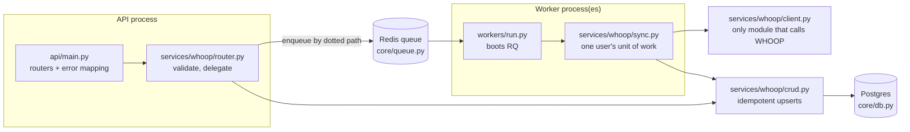
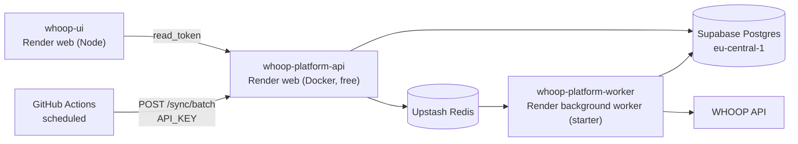

# whoop-service

## Responsibility

Connects a person's WHOOP account and keeps everything WHOOP exposes — cycles (day strain), recovery, sleep, workouts, body measurements and profile — synced into Postgres, for any number of users at once. It owns the platform's identity: the `read_token` it issues at connect time is the same credential whoop-insight-service, whoop-nutrition-service and the UI use to act as that person. Everything downstream — insights, nutrition context, the dashboard — reads data this service wrote.

It does two things and nothing else: the OAuth connect flow, and fanning sync work out across worker processes instead of looping over users in one process.

## Design — code structure



```
whoop-service/
├── api/main.py            # aggregates routers, maps DomainError -> HTTP; no business logic
├── workers/run.py         # boots an RQ worker; no business logic
├── core/                  # product-agnostic: config, db, redis, queue, auth, crypto, logging
├── services/whoop/        # everything WHOOP-specific
│   ├── router.py          # HTTP routes
│   ├── sync.py            # orchestration: token refresh -> fetch -> upsert -> SyncJobLog
│   ├── client.py          # WHOOP HTTP: OAuth exchange/refresh, paginated fetch, retries
│   ├── circuit_breaker.py # shared fast-fail when WHOOP is down
│   ├── crud.py            # upserts keyed on (user_id, whoop_record_id)
│   └── models.py          # users, recoveries, sleeps, workouts, sync/activity logs
├── alembic/               # migrations (version table: alembic_version)
└── tests/                 # offline: respx-mocked WHOOP, real local Postgres/Redis
```

The split that matters is `core/` versus `services/whoop/`. `core/` never mentions WHOOP — no field names, no URLs — so a second product can reuse it unchanged. `services/whoop/` reaches Redis and RQ only through `core/queue.py`. Two levers scale the sync independently: the number of worker processes (how many users sync at once) and `WHOOP_FETCH_CONCURRENCY` (how many requests one sync makes to WHOOP at once).

## Design — hosting



Two Render services from one image: the API (`uvicorn`) and the worker (`python -m workers.run`), both in Frankfurt next to the Supabase database. The region matters more than it looks — `core/db.py` uses `NullPool` because Supabase's pooler already pools, so every session opens a fresh TLS connection and pays the full round trip. Free-plan Render services don't run `preDeployCommand`, so migrations are applied by hand before a schema-changing deploy. See `render.yaml` and [`docs/hosting.md`](../docs/hosting.md).

## Walkthrough

**1. Connect.** The browser hits `GET /auth/login`, which stores a CSRF `state` plus a PKCE verifier in Redis and redirects to WHOOP. WHOOP redirects back to `GET /auth/callback`; the service checks `state`, exchanges the code (sending the verifier), asks WHOOP whose account it is (`/v2/user/profile/basic`), encrypts both tokens with `TOKEN_ENCRYPTION_KEY`, and stores them on that account's user — created on first connect, updated on reconnect, so one WHOOP account is always one user with one stable `read_token`. It then enqueues a sync and redirects to the frontend with a one-time code — never the `read_token` itself in a URL.

**2. Hand over identity.** The frontend's server calls `POST /auth/exchange` with that code. Redis `GETDEL` makes the code single-use; the response carries `userId` and `readToken`, which the UI keeps in an `httpOnly` cookie.

**3. Sync.** A job runs `sync_one_user(user_id)` in a worker:

```python
# services/whoop/sync.py
user = await crud.get_user(db, user_id)
token = await _valid_token(user, db)              # refresh + re-encrypt if expired
last_sync = await crud.last_successful_sync_at(db, user_id)
since = last_sync - timedelta(days=SYNC_OVERLAP_DAYS) if last_sync else None
recoveries, sleep, workouts = await client.fetch_all(token, since)
for r in recoveries:
    await crud.upsert_recovery(db, user_id, r)    # ON CONFLICT (user_id, whoop_record_id)
...
await db.commit()                                 # once for the whole batch
```

`fetch_all` fetches every collection — recovery, sleep, workouts, cycles — plus the body measurement. Each record lands in typed columns for the metrics worth querying (HRV, resting HR, SpO₂, sleep stages and need, HR zones, energy…) and in full as `raw` JSON. It follows WHOOP's `next_token` pagination (25 per page, capped at 40 pages), fetches the three collections concurrently under a semaphore, retries 429/5xx with backoff, and consults a Redis circuit breaker first so a WHOOP outage fails fast for every job instead of each one burning its own retries. The first sync pulls full history; later ones start from the last successful sync minus a 3-day overlap, because WHOOP scores recent records after the fact. Upserts skip rows whose content hash is unchanged, so re-syncing is cheap and idempotent. Every attempt writes a `SyncJobLog` row. If WHOOP rejects the refresh token outright (400/401 — revoked, or already rotated away), the user is marked disconnected so the batch stops retrying them until they reconnect.

Syncs are triggered three ways: at login, by the dashboard's refresh (`POST /users/{id}/sync`, debounced per user for 60s), and by the scheduled `POST /sync/batch`, which enqueues one job per connected user in a single pipelined Redis call.

**4. Read.** `GET /users/{id}/recovery|sleep|workout` return that user's rows with an `ETag`, so an unchanged dashboard refresh is a `304`. Every per-user route accepts either the operator `API_KEY` or that user's own `read_token` (`services/whoop/auth.py`).

## API

| Route | Auth | Purpose |
|---|---|---|
| `GET /auth/login` | — | Start WHOOP OAuth (state + PKCE) |
| `GET /auth/callback` | — | Finish OAuth, enqueue first sync, redirect with one-time code |
| `POST /auth/exchange` | — | Redeem the one-time code for `userId` + `readToken` |
| `POST /users/{id}/sync` | user | Queue a sync (debounced) |
| `GET /users/{id}/recovery` · `/sleep` · `/workout` · `/cycles` | user | Synced records with every metric, newest first, `ETag`-aware |
| `GET /users/{id}/profile` | user | Name and latest body measurement |
| `GET /users/{id}/syncs` · `/activity` | user | Recent sync attempts / API activity |
| `POST /sync/batch` | API key | Fan out one sync per connected user |
| `GET /health` | — | Postgres + Redis reachable |

## Running locally

```bash
uv sync
docker compose up -d postgres redis         # 5432 / 6379
cp .env.example .env                        # fill in WHOOP + key values
uv run alembic upgrade head
uv run uvicorn api.main:app --reload        # :8000
uv run python -m workers.run                # in a second terminal
uv run ruff check . && uv run mypy . && uv run pytest
```
